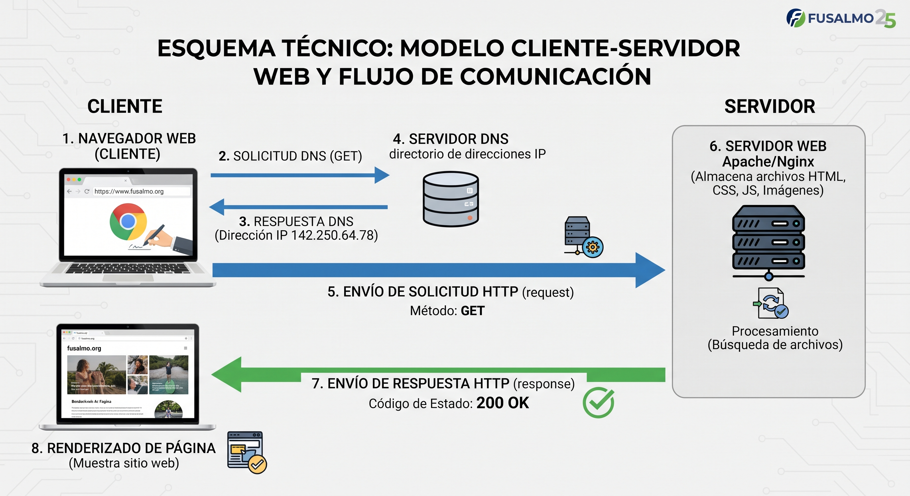

# Bitácora Full Stack - Samuel Castellón

Repositorio de evidencias y laboratorios del curso **Desarrollo Web [Full Stack Junior]** impartido en Fusalmo Santa Ana.

## Día 1 (13 de noviembre): Fundamentos de la web

### 1. Esquema cliente-servidor
A continuación se ilustra el flujo de comunicación entre el navegador (cliente) y el servidor web, pasando por la resolución de nombres (DNS):

*(Nota: El diagrama detalla los 6 pasos principales del protocolo HTTP, incluyendo el método `GET` y el código de estado `200 OK`)*.

### 2. Dominio, hosting y servidor
Tabla comparativa de los elementos esenciales para publicar un sitio web:

| Criterio | Dominio | Hosting | Servidor |
| :--- | :--- | :--- | :--- |
| **¿Qué es?** | El nombre único que identifica a un sitio web en Internet. | El servicio de alquiler de espacio digital en una computadora remota. | La computadora física o virtual que almacena los archivos y responde a las solicitudes. |
| **¿Para qué sirve?** | Permite que los usuarios accedan al sitio mediante una dirección fácil de recordar en lugar de una IP. | Almacena los archivos HTML, CSS, JS e imágenes para que estén accesibles 24/7 en la red. | Procesar las peticiones HTTP y devolver los recursos solicitados por los navegadores. |
| **¿Tiene costo? (Aprox.)** | Sí, se paga una renta anual (aprox. $10 - $20 USD/año según la extensión como `.org` o `.com`). | Sí, varía según el proveedor y capacidad (desde $3 hasta $15+ USD/mes). | Varía según sea físico propio, VPS o dedicado en la nube (desde $5 hasta más de $50+ USD/mes). |
| **Ejemplo real** | `fusalmo.org` | Hostinger, GitHub Pages, Netlify | Servidor Linux configurado con Apache o Nginx |

### 3. Análisis de sitio web con DevTools
* **Sitio analizado:** Fusalmo (fusalmo.org)
* **Número total de solicitudes (Requests):** 42 requests
* **Primera solicitud (HTML):** Método `GET`, Código de estado `200 OK`.
* **Tipos de archivos identificados:** Documentos HTML, hojas de estilo CSS, scripts JS e imágenes (PNG/SVG).
* **Tiempo de carga (Load):** 1.1s

### 4. Reflexión sobre el uso de Inteligencia Artificial
Durante esta práctica utilicé herramientas de IA generativa como apoyo técnico para estructurar la base inicial de este documento en Markdown y contrastar conceptos teóricos.
* **Lo que se utilizó:** Consultas para definir la jerarquía de títulos y etiquetas de tablas en Markdown.
* **Verificación crítica:** No se aceptó ciegamente la información generada; se contrastó la sintaxis con la documentación oficial y se redactaron los conceptos con criterios propios adaptados al entorno de desarrollo.
* **Buenas prácticas:** Se evita compartir información sensible o tokens personales, validando siempre el código antes de ejecutar los comandos en la terminal.

## Historial de avances
- Configuración inicial del entorno (VS Code, Git y GitHub).
- Creación de estructura base del proyecto y documentación completa en Markdown (`README.md`).